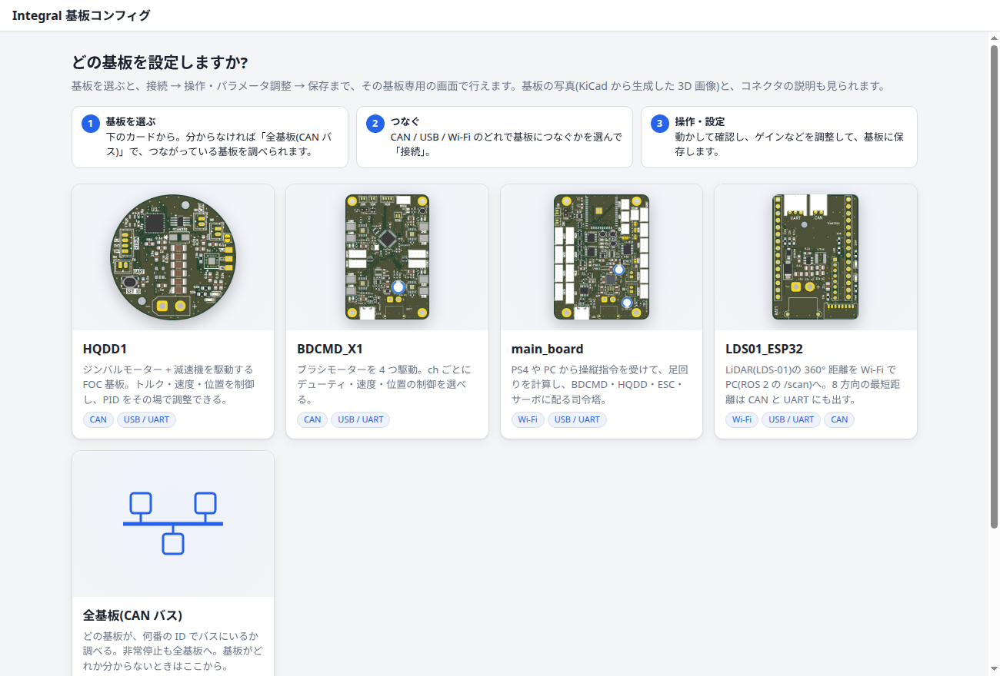

# Integral 基板 Web UI

Integral のロボコン用基板 **HQDD1 / BDCMD_X1 / main_board / LDS01_ESP32** を、ブラウザから設定・操作する Web UI です。
最初に基板を選び、つなぎ方を選んで接続すると、その基板専用の画面で、動かす・パラメータを調整する・保存する、までできます。

*A browser UI to connect to, drive and tune the Integral robot boards (HQDD1, BDCMD_X1, main_board, LDS01_ESP32) over CAN / UART(USB) / Wi-Fi(UDP). Documentation is mostly in Japanese.*



## できること

| 基板 | つなぎ方 | 画面でできること |
|---|---|---|
| **[HQDD1](https://github.com/IntegralIndustries/hqdd1)** | CAN / UART | トルク・速度・位置の運転、PID・制限値の調整、フラッシュへの保存、出荷状態に戻す、高速キャプチャ(ステップ応答)、リアルタイムグラフ |
| **[BDCMD_X1](https://github.com/IntegralIndustries/bdcmd_x1)** | CAN / UART | 4ch それぞれのモード(デューティ / 速度 / 位置)と目標、基板全体と ch ごとのパラメータ、状態フラグ、保存、グラフ |
| **[main_board](https://github.com/IntegralIndustries/main_board)** | USB / Wi-Fi(UDP) | 足回りの操縦(円・キーボード)、非常停止、サーボ・ESC・モーターの出力、CAN の中継、状態グラフ、**Wi-Fi の接続先の設定(USB)、ゲームパッド(PS4 以外も)での操縦、エンコーダの数値表示、`robot_config.h` の作成(独立ステアの可動範囲・外部エンコーダを含む)** |
| **[LDS01_ESP32](https://github.com/IntegralIndustries/lds01_esp32)** | Wi-Fi(UDP) / UART / CAN | LiDAR の点群(360°)と 8 方向の最短距離の表示、START / STOP、**`config.h` の作成** |
| **全基板(CAN バス)** | CAN | バスにいる基板と ID の一覧、流れているフレームの表示、全基板への非常停止 |

各基板の画面には、**「基板情報」タブ**があります。基板の写真(下記の注)に番号を付けて、コネクタ・スイッチ・LED の説明、はじめ方、注意点をまとめています。

> 写真は、各基板リポジトリの KiCad ファイルから生成した上面の 3D 画像です(実物の写真ではありません)。実物の写真に差し替えるときは、`static/img/boards/<基板名>.webp` を置き換えてください(番号の位置は `static/js/boards/index.js` の `photo.pins` で、画像に対する % 指定です)。画像は `tools/render_boards.sh` で作り直せます。

## 公開ページ

<https://integralindustries.github.io/integral_webui/> で、インストールなしで使えます(GitHub Pages)。ただし公開ページは https なので、**USB シリアルとファームウェア書き込みだけ**です。CAN と Wi-Fi(UDP)は、下の `server.py` をローカルで動かして `http://localhost:8080` を開いてください。

## ファームウェアの書き込み(ブラウザから)

基板の画面の「ファームウェア書き込み」タブから、ST-Link や PlatformIO なしで書き込めます(Chrome / Edge)。

| 基板 | 方法 | 準備 |
|---|---|---|
| main_board / LDS01_ESP32 | [esptool-js](https://github.com/espressif/esptool-js)(Web Serial) | USB でつなぐ。`firmware.bin`(0x10000)。新品は `bootloader.bin` / `partitions.bin` / `boot_app0.bin` も(ファイル名からアドレスを自動で入れます) |
| BDCMD_X1 | USB DFU(WebUSB、DfuSe をこのリポジトリで実装) | SW1 を押したまま USB をつなぐ。`firmware.bin` を 0x08000000 へ。新しい基板は、書き込み後にオプションバイトの変更が必要(画面にも出ます) |
| HQDD1 | 非対応 | USB がないので ST-Link(SWD)で書き込む |

「同梱の…」ボタンは、このリポジトリの `static/firmware/` に入れてあるビルド済みファイルを使います(PC にファイルを用意しなくても書き込めます)。自分でビルドしたものを使うときは、`pio run` でできる `.pio/build/<env>/*.bin` を選ぶか、各リポジトリの GitHub リリースから取得します(リリースを作ると「GitHub のリリースから取得」で選べます)。書き込む前に、ファイルの種類(ESP32 は先頭 0xE9、STM32 はスタックポインタとリセットベクタ)を確認し、確認ダイアログを出します。esptool-js は jsDelivr の CDN から読み込みます(オフラインでは ESP32 の書き込みは使えません)。

> DFU の書き込みは、実機のない環境で、DfuSe の手順を真似たモックでテストしています。実機での確認はまだです。うまくいかないときは、`dfu-util` や STM32CubeProgrammer と同じ結果になるか比べてください。

### 同梱のファームウェアを更新する

各基板リポジトリ(main_board / lds01_esp32 / bdcmd_x1)の GitHub Actions「Build firmware」が作った最新のビルドを取り込みます。基板のファームウェアを更新したら、Actions で「Build firmware」を実行(または `v*` のタグを push)してから、`gh auth login` 済みの PC で:

```bash
python3 tools/update_firmware.py     # static/firmware/ を更新(manifest.json にコミットの版が入る)
git add static/firmware && git commit -m "同梱のファームウェアを更新" && git push
```

同梱のものは**既定の設定**(main_board は足回りがメカナム 4 輪、LDS01_ESP32 は ID 0)でビルドされています。ロボットに合わせた設定が要るときは、「robot_config.h 作成」で作って、自分でビルドしてください。main_board の Wi-Fi は、書き込んだあと「Wi-Fi 設定」(USB)で接続先を保存します。

## 使い方

### USB / UART だけなら、サーバ不要

公開ページを開くか、Chrome か Edge で `static/index.html` を配信するだけで使えます(Web Serial。Firefox / Safari は非対応)。

```bash
cd static && python3 -m http.server 8099      # → http://localhost:8099
```

### CAN と Wi-Fi(UDP)も使うなら、`server.py` を動かす

ブラウザは CAN も UDP も直接は扱えないので、PC 上の小さな中継サーバ(`server.py`)を使います。サーバはバイト列を運ぶだけで、プロトコルの解釈はすべてブラウザ側にあります。

```bash
pip install -r requirements.txt               # aiohttp と pyserial
# CAN アダプタを can0 として立ち上げる(Linux の SocketCAN。1 Mbps)
sudo ip link set can0 up type can bitrate 1000000
#   slcan 系のアダプタ: sudo slcand -o -c -s8 /dev/ttyACM0 can0 && sudo ip link set can0 up
python3 server.py                             # → http://localhost:8080
```

画面上部のバーで、つなぎ方(CAN / USB・UART / Wi-Fi)、ID(「自動」でもよい)、I/F・ポート・ホストを選んで「接続」を押します。

- サーバは既定で `127.0.0.1` だけで待ち受けます。`--host 0.0.0.0` にすると同じ LAN の誰でもモーターを動かせるので、注意してください。
- WebSocket は、別のサイトのページからは接続できません(Origin を確認しています)。
- 接続を切るとき、ブラウザを閉じたときは、基板に**停止コマンドを自動で送ります**(HQDD1 は `S`、BDCMD_X1 は `S`、main_board は `V 0 0 0` と `D 0`)。画面の「切断・終了時に停止を送る」で切れます。

### ハードウェアなしで試す

```bash
python3 tools/sim_boards.py --udp                       # main_board と LDS01_ESP32 を localhost で演じる(ホストに 127.0.0.1)
# CAN も試すなら vcan を作る(Linux)
sudo modprobe vcan && sudo ip link add dev vcan0 type vcan && sudo ip link set vcan0 up
python3 tools/sim_boards.py --can vcan0 --udp           # HQDD1(ID 1)/ BDCMD_X1(ID 0)/ LDS(ID 0)/ main_board の生存通知
python3 server.py
```

シミュレータは各基板の通信仕様に沿って作ってありますが、動力学は簡略化しています。実機の挙動の確認には使わないでください。

## 基板ごとの注意(画面にも出します)

- **BDCMD_X1 は、動作の指令が 500 ms(既定)途切れると全 ch を止めます。** この UI は、指令した目標を 200 ms ごとに送り続けます(切ることもできます)。
- **HQDD1 には、通信が途絶えたときに止まる機能がありません。** 最後の指令のまま動き続けます。画面を閉じるときの停止コマンドと、Esc キーでの停止を使ってください。
- **main_board の足回りは起動時は無効**です。「有効 (D 1)」を押してから動かします。PS4 がつながっている間は PC の速度指令は無視されます。円を押している間だけ `V` を送り、離すと `V 0 0 0` を送ります。
- 足回りの種類や、各輪をどの基板で動かすかは**ビルド時の設定**(`robot_config.h`)です。実行中の基板には送れないので、「robot_config.h 作成」タブで作って、書き込みます。既存の `robot_config.h` を読み込めば、該当する行だけを書き換えて、ほかの部分はそのまま残します。LDS01_ESP32 の `config.h`(CAN の ID など)も同じです。

## 構成

```
integral_webui/
├── server.py            中継サーバ(CAN / UART / UDP ⇔ WebSocket)。プロトコルは解釈しない
├── static/
│   ├── index.html
│   ├── css/style.css
│   ├── img/boards/      基板の画像(KiCad から生成)
│   └── js/
│       ├── app.js           画面の枠組み(基板の選択、接続バー、タブ、基板情報)
│       ├── transport.js     経路の切り替え(サーバ経由 / Web Serial)
│       ├── protocol.js      各基板の通信仕様(デコード・エンコード)。画面なし、テストあり
│       ├── chart.js         リアルタイムグラフ
│       ├── ui.js            画面部品
│       └── boards/          基板ごとの画面(hqdd1, bdcmd_x1, main_board, lds01_esp32, can_monitor)、基板情報(index.js)、書き込み(flasher.js)
├── tests/               protocol.js の単体テスト(node --test tests/)
└── tools/
    ├── render_boards.sh     基板画像を KiCad ファイルから作る
    └── sim_boards.py        基板のシミュレータ
```

基板を追加するには、`static/js/boards/` に画面のモジュール(`create(ctx)` と `stopCmds(conn)` を持つもの)を足し、`index.js` に基板の説明を足します。通信仕様の解釈は `protocol.js` に、テストと一緒に足します。

## 関連リポジトリ

通信仕様の原本は、各基板のリポジトリの `docs/communication_spec.md` と、main_board の `docs/can_id_map.md` です。仕様が変わったら、`protocol.js` と各画面を合わせて直してください。

| リポジトリ | 内容 |
|---|---|
| [hqdd1](https://github.com/IntegralIndustries/hqdd1) | QDD アクチュエータ。この UI の元になった `webui/` がある |
| [bdcmd_x1](https://github.com/IntegralIndustries/bdcmd_x1) | 4ch ブラシモータードライバ |
| [main_board](https://github.com/IntegralIndustries/main_board) | メイン制御基板(CAN ID の原本もここ) |
| [lds01_esp32](https://github.com/IntegralIndustries/lds01_esp32) | LDS-01 の Wi-Fi 送信基板 |

## ライセンス

他の Integral の基板リポジトリと同じです。**非商用であれば自由に使えます。** ソフトウェアは [PolyForm Noncommercial 1.0.0](LICENSES/PolyForm-Noncommercial-1.0.0.md)、画像と文書は [CC BY-NC 4.0](LICENSES/CC-BY-NC-4.0.txt)。詳しくは [LICENSE](LICENSE)。
